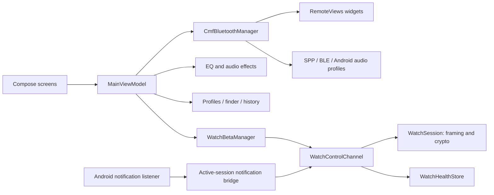

# Architecture

## Android app

Kotlin, Jetpack Compose, StateFlow and coroutines. Android 8.0+; compile/target SDK 35. `MainActivity` hosts the tabs and dialogs; `MainViewModel` owns screen-scoped managers. `CmfApplication` initializes earbud profile proxies, the watchdog and widget updates.

## Earbuds

`bluetooth/BluetoothManager.kt` manages SPP, BLE and Android profile status. `protocol/CmfProtocol.kt` builds/parses vendor packets and CRC16. Discovery is filtered to CMF Buds Pro 2. ANC commands trigger a status read; the UI distinguishes sending from a received mode response. Bass/game state still reflects a successful transport write rather than independent firmware confirmation.

## Audio

`EqualizerManager` persists five-band curves and custom presets. Android `Equalizer` and other audio effects depend on the phone/player's audio session. `BluetoothCodecManager` requests earbud high-quality mode; the app does not force or verify Android's negotiated LDAC bitrate.

## Watch beta

`WatchBetaManager` handles bounded BLE scans, GATT lifecycle, standard reads and reconnect retries. DEV is a local session gate. `WatchControlChannel` subscribes to shell/command notifications, serializes GATT writes, times out operations and drives authorization/sync. `WatchSession` handles F5 framing, chunk assembly, SHA-256 key derivation, signature verification, CRC32 and AES-CBC session traffic.

`WatchHealthStore` deduplicates activity/vital/sleep records per device, aggregates by local day and bounds local history. No raw notification contents or session secrets are persisted. The existing notification listener forwards only explicitly selected eligible apps to an active authenticated session.

Protocol reference: [CMF Watch Pro 2 BLE Protocol](https://github.com/joshuapassos/CMF-Watch-Pro-2-BLE-Protocol). Physical-device validation remains necessary.

## Widgets and persistence

Seven `AppWidgetProvider` entries share RemoteViews rendering and immutable explicit PendingIntents. Appearance settings currently apply globally. Preferences store EQ curves, profiles, histories and widget choices. Watch health and notification choices are excluded from Android backup rules.

## Updates and releases

`GitHubUpdateManager` checks release sources and downloads APKs through HTTPS redirects. Android's package installer performs installation. A `v*` tag starts the release workflow and attaches `CMF_Buds_Pro_2_Manager.apk`; `version.json` provides fallback metadata.

## Verification

`./gradlew testDebugUnitTest assembleRelease` runs four protocol tests and builds the release. These tests verify host-side framing/authentication behavior, not live firmware compatibility. Remaining risks and planned validation are tracked in [ROADMAP.md](ROADMAP.md).
