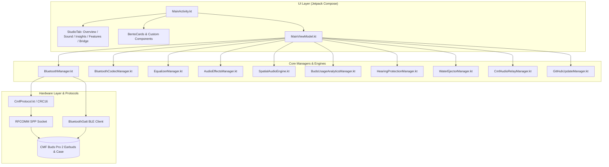
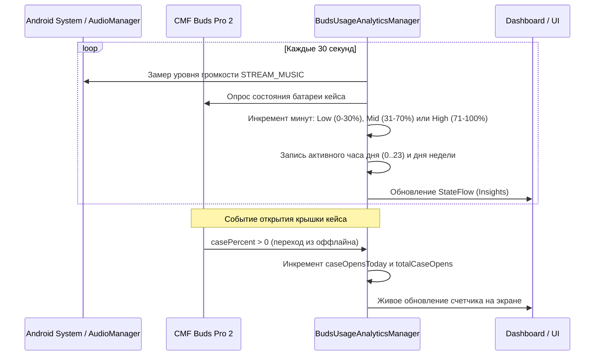

# Архитектура и кодовая база CMF Buds Pro 2 Manager

Полное техническое руководство по устройству проекта, протоколу связи с наушниками, подсистемам звука, аналитики и пользовательского интерфейса.

---

## 1. Обзор архитектуры

Приложение построено по архитектуре **Clean Architecture + MVI/MVVM** на современном стеке Android:
- **UI Toolkit:** Jetpack Compose (Material 3 + кастомная дизайн-система Cyber Glass/AMOLED).
- **Асинхронность и реактивность:** Kotlin Coroutines & `StateFlow`.
- **Bluetooth связь:** Прямой двухуровневый стек:
  - **BLE GATT:** опрос стандартных сервисов Battery Service (UUID `0x180F`).
  - **RFCOMM / SPP:** проприетарный сервисный канал Nothing (UUID `aeac4a03-dff5-498f-843a-34487cf133eb`).



---

## 2. Структура пакетов (`app/src/main/java/com/cmf/budscontroller/`)

| Пакет | Назначение | Ключевые классы |
|---|---|---|
| `protocol/` | Двоичный протокол Nothing/CMF, упаковка/распаковка пакетов, CRC16 | `CmfProtocol.kt`, `Crc16.kt` |
| `bluetooth/` | Управление Bluetooth-жизненным циклом, RFCOMM SPP сокетом и GATT клиентом | `BluetoothManager.kt` |
| `audio/` | Студийный эквалайзер, системные эффекты, переключение LDAC и 3D звук | `BluetoothCodecManager.kt`, `EqualizerManager.kt`, `SpatialAudioEngine.kt`, `AdvancedAudioLab.kt` |
| `analytics/` | Сбор реальной статистики громкости, износа аккумулятора и защита слуха ВОЗ | `BudsUsageAnalyticsManager.kt`, `BatteryAnalyticsManager.kt`, `HearingProtectionManager.kt` |
| `tools/` | Фирменные утилиты: выдувание воды звуком, колесико Smart Dial, поиск Sonar | `WaterEjectorManager.kt`, `SmartDialManager.kt`, `FindMyBudsManager.kt`, `SleepTimerManager.kt`, `VoiceWhisperManager.kt` |
| `relay/` | Аудио-мост с ПК: локальный TCP-сервер 4242 для трансляции PCM-звука | `CmfAudioRelayManager.kt` |
| `sensor/` | Акустический мониторинг окружающего шума через микрофон для Auto ANC | `AmbientNoiseDetector.kt` |
| `service/` | Быстрые переключатели Android Quick Settings Tile в шторке | `CmfAncTileService.kt`, `CmfGameModeTileService.kt` |
| `i18n/` | Автоматическая локализация (English / Русский) | `AppStrings.kt` |
| `update/` | Встроенный OTA-апдейтер через GitHub Releases | `GitHubUpdateManager.kt` |
| `ui/` | Главный экран, ViewModel, темы и карточки интерфейса | `MainActivity.kt`, `MainViewModel.kt`, `theme/`, `components/` |

---

## 3. Протокол связи CMF/Nothing (`protocol/CmfProtocol.kt`)

Связь с чипом наушников (BES2600 / Bestechnic) осуществляется через последовательный RFCOMM SPP сокет с UUID:
`aeac4a03-dff5-498f-843a-34487cf133eb`.

### Структура двоичного пакета (Binary Frame):
```
[0x55, 0x60, 0x01, CmdLo, CmdHi, PayloadLen, 0x00, Seq, ...Payload, CrcLo, CrcHi]
```
- `0x55, 0x60`: Магические байты заголовка (Magic bytes).
- `0x01`: Версия протокола (Protocol version).
- `CmdLo, CmdHi`: 16-битный код команды (Little-Endian).
- `PayloadLen`: Длина полезной нагрузки в байтах.
- `0x00`: Резервный флаг.
- `Seq`: Инкрементный номер последовательности (`0x00..0xFF`).
- `Payload`: Байты параметров команды.
- `CrcLo, CrcHi`: Контрольная сумма CRC-16-CCITT (Little-Endian), вычисленная по всем предшествующим байтам пакета.

### Поддерживаемые команды:
| Код команды | Константа | Описание |
|---|---|---|
| `0xC007` | `CMD_READ_BATTERY` | Запрос заряда левого/правого наушника и кейса |
| `0xC01E` | `CMD_READ_ANC` | Запрос текущего режима шумоподавления |
| `0xF00F` | `CMD_SET_ANC` | Переключение ANC (`0x01` выкл, `0x02` прозрачность, `0x03` активный) |
| `0xF010` | `CMD_SET_EQ` | Установка уровня Ultra Bass (`0..5`) |
| `0xF040` | `CMD_SET_LATENCY` | Переключение Game Mode / Low Latency (`0x01` вкл, `0x02` выкл) |
| `0xF050` | `CMD_FIND_MY_BUDS` | Акустический маяк («поиск наушников») |
| `0xF05A` | `CMD_SET_HD_AUDIO` | Аппаратное включение чипа **Sony LDAC** в прошивке наушников |

---

## 4. Подсистемы звука и аппаратного кодека (`audio/`)

### 1. BluetoothCodecManager (`BluetoothCodecManager.kt`)
Управляет двусторонней связкой «телефон ➔ наушники»:
1. Отправляет на наушники пакет `CMD_SET_HD_AUDIO` (`0xF05A`), заставляя DSP-чип наушников активировать аппаратный декодер Sony LDAC (или переключиться на энергосберегающий AAC/SBC).
2. Выставляет приоритет A2DP кодека в подсистеме Android Audio HAL через скрытые системные настройки (`bluetooth_a2dp_codec_priority`).

### 2. EqualizerManager (`EqualizerManager.kt`)
Подключается напрямую к аудиопотоку системы через Android `android.media.audiofx.Equalizer`:
- 5 аппаратных полос (60 Hz, 230 Hz, 910 Hz, 3.6 kHz, 14 kHz) с шагом от -10 dB до +10 dB.
- Встроенные пресеты: *Balanced*, *Bass Boost*, *Treble Boost*, *Vocal*, *Electronic*, *Rock*.

### 3. SpatialAudioEngine (`SpatialAudioEngine.kt`)
Программный виртуализатор звукового пространства (360°):
- Режимы: *Стерео*, *Концертный зал*, *Кинотеатр*.
- Интеграция с `Virtualizer` и `PresetReverb`.

---

## 5. Подсистема реальной аналитики (`analytics/`)

В отличие от стандартных заглушек, аналитика CMF Buds Pro 2 Manager работает в фоне на реальных событиях:



- **Расчет автономности:** вычисляется динамически на базе реального профиля громкости ($7.5\text{ ч} - \text{highVolRatio} \times 1.7\text{ ч}$).
- **Износ аккумулятора:** рассчитывается по фактически пройденным 500-минутным циклам воспроизведения.
- **Защита слуха ВОЗ (`HearingProtectionManager.kt`):** интеграция стандарта безопасного прослушивания (экспоненциальный рост дозы при звуке >70% громкости, рекомендация 10-минутного отдыха при непрерывной сессии свыше 50 минут).

---

## 6. Утилиты (`tools/`)

### 1. WaterEjectorManager (`WaterEjectorManager.kt`)
Выдувание влаги и пыли из акустической сетки динамиков:
- Генерирует непрерывный 18-секундный звуковой поток через низкоуровневый `AudioTrack` (PCM 16-bit, 48 kHz).
- **Фаза 1 (1–6 сек):** Суббасовый резонансный свип (130–170 Гц) для максимальной механической экскурсии мембраны.
- **Фаза 2 (7–12 сек):** 8 Гц импульсные ударные волны с амплитудной модуляцией.
- **Фаза 3 (13–18 сек):** Ультразвуковая микродисперсия (дуальная частота 160 Гц + 9.8 кГц для очистки наружной сетки).
- **Безопасность:** перед стартом запоминает исходный уровень громкости пользователя и гарантированно возвращает его в блоке `finally`.

### 2. SmartDialManager (`SmartDialManager.kt`)
Обрабатывает сигналы вращения и нажатия на физическое колесико кейса CMF Buds Pro 2:
- Вращение: регулировка громкости, переключение ANC, регулировка Ultra Bass.
- Нажатие: Play/Pause, Game Mode, Mute или запуск системного голосового ассистента (`ACTION_VOICE_COMMAND`).

---

## 7. Сетевой аудио-мост (`relay/CmfAudioRelayManager.kt`)

Позволяет использовать CMF Buds Pro 2 как беспроводные наушники для компьютера с минимальной задержкой:
1. Телефон запускает серверный сокет `ServerSocket(4242)`.
2. ПК подключается по USB (через `adb forward tcp:4242 tcp:4242`) или по локальной сети Wi-Fi.
3. Windows-скрипт захватывает системный звук WASAPI в формате Raw PCM (48 kHz / 16-bit stereo) и транслирует в сокет.
4. Телефон принимает аудио-пакеты и воспроизводит их в наушники с задержкой ~15–35 мс.

---

## 8. Дизайн-система (`ui/theme/`)

Интерфейс оптимизирован под современные экраны (20:9, 1.5K AMOLED на POCO X7 Pro / Nothing Phone):
- **OLED Charcoal Black (`#08090C`):** истинный глубокий черный фон с нулевым энергопотреблением на AMOLED.
- **Ultra-Vivid CMF Orange (`#FF5722` / `#FF3D00`):** фирменный насыщенный оранжевый акцент бренда.
- **Electric Cyan (`#00E5FF`) & Neon Green (`#00E676`):** высококонтрастные неоновые статусы.
- **Cyber Stage:** радиальная подсветка витрины наушников и кейса.
- **Стеклянные Bento-карточки:** градиентные обводки с зеркальным бликом specularity.

---

## 9. Сборка и деплой

```bash
# Клонирование репозитория
git clone https://github.com/copilotfather/cmf-buds-pro-2-manager.git
cd cmf-buds-pro-2-manager

# Сборка подписанного релизного APK
./gradlew assembleRelease --no-daemon

# Установка на подключенное устройство через ADB
adb install -r app/build/outputs/apk/release/app-release.apk
```
