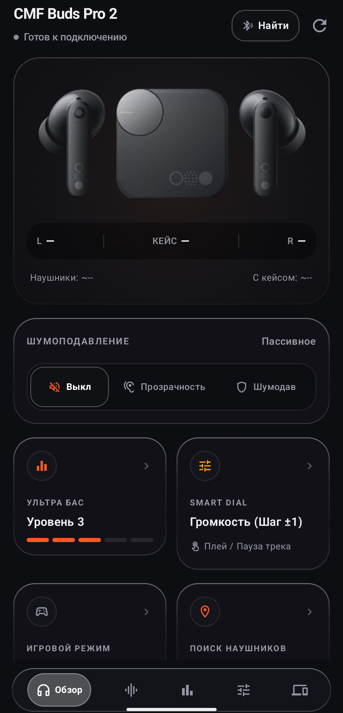
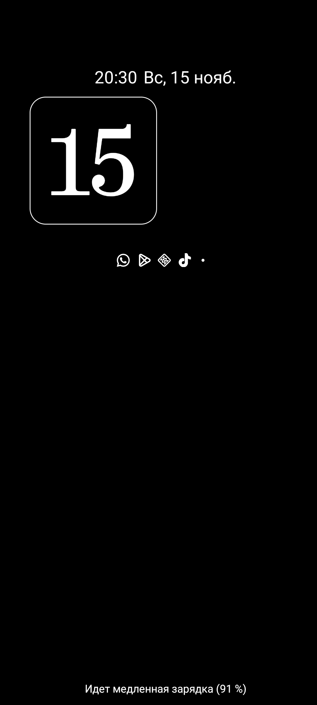
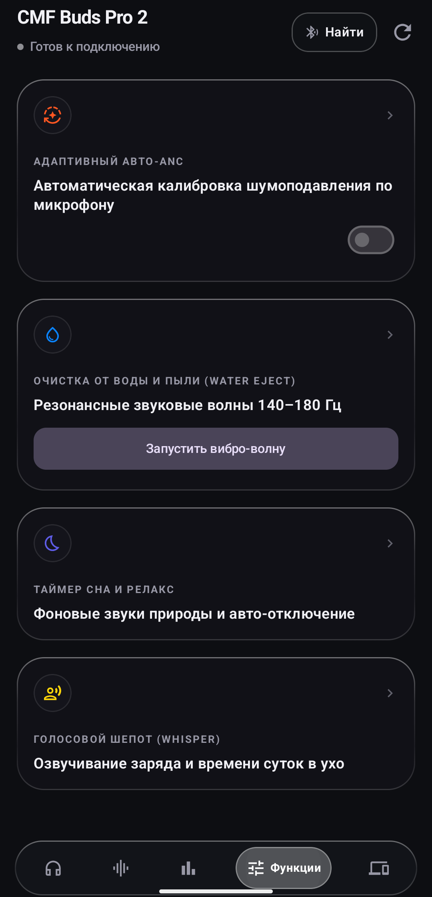

<div align="center">


# 🔘 CMF Buds Pro 2 Manager

### *Next-Generation Studio Audio Controller & Hardware Companion for Nothing CMF Buds Pro 2*

<p align="center">
  <a href="https://github.com/copilotfather/cmf-buds-pro-2-manager/releases"></a>
  <a href="https://github.com/copilotfather/cmf-buds-pro-2-manager/releases"></a>
  <a href="LICENSE"></a>
  
  
  
</p>

<br/>

<p align="center">
  <b><a href="#-english-documentation">English Documentation</a></b> • 
  <b><a href="#-русская-документация">Русская Документация</a></b> • 
  <b><a href="https://github.com/copilotfather/cmf-buds-pro-2-manager/releases/latest">⚡ Download APK (v2.2.0)</a></b>
</p>

<br/>

---

### 📱 Visual Interface Showcase

<table>
  <tr>
    <td align="center" width="25%"><b>💎 Overview & Controls</b></td>
    <td align="center" width="25%"><b>📊 Deep Analytics</b></td>
    <td align="center" width="25%"><b>🎛️ Studio Master EQ</b></td>
    <td align="center" width="25%"><b>🛠️ Hardware Tools</b></td>
  </tr>
  <tr>
    <td align="center"></td>
    <td align="center"></td>
    <td align="center"></td>
    <td align="center"></td>
  </tr>
</table>

---

</div>

<br/>

<a name="-english-documentation"></a>
## 🇬🇧 English Documentation

**CMF Buds Pro 2 Manager** is an independent Android application engineered exclusively for Nothing's **CMF Buds Pro 2** earphones. Built entirely in Kotlin and Jetpack Compose, it establishes direct low-level communication with the earbuds via **Bluetooth RFCOMM / SPP protocols (BES chipset commands)**, unlocking advanced audio fidelity, deep telemetry, and hardware features beyond the factory software.

### 🌫️ Liquid Gray Glass Design Language
* **Smoked Glass Surfaces:** Translucent matte cards with physical depth and specular rim highlights.
* **Hardware Fluidity:** Native 60 / 120 FPS GPU pipeline without heavy springs or UI micro-stutters.
* **Floating Glass Island:** Minimalist bottom dock with soft glow indicators.

---

### ⚡ Feature Breakdown

#### 1. 📡 Hi-Res Audio Codec Engine
* **Sony LDAC (990 kbps, 24-bit / 96 kHz):** Audiophile wireless playback directly activated through system A2DP routing.
* **Hardware SPP Command:** Sends low-level `0xF05A` vendor opcode sequences straight to the internal BES Bluetooth controller.
* **Full Codec Support:** LDAC, LHDC V5, Qualcomm aptX HD / Adaptive, AAC, and SBC.

#### 2. 📊 Deep Usage & Battery Telemetry
* **SPL Decibel Tiers:** Logs time spent across *Low (0–30%)*, *Mid (31–70%)*, and *High (71–100%)* volume to preserve hearing health.
* **Weekly Activity Histogram:** Day-by-day playback visualization highlighting peak listening days and favorite listening hours.
* **Case Lid Counter:** Hardware-level counter logging daily and all-time case open/close events.
* **Battery Health Index:** Empirical calculation of real battery longevity from 100% full charge and cell degradation.

#### 3. 🎛️ Studio Master Equalizer
* **Live Bezier Spline:** Real-time frequency response curve drawn directly on hardware Canvas.
* **5-Band Precision Sliders:** 60 Hz, 230 Hz, 910 Hz, 3.6 kHz, 14 kHz with ±1 dB precision.
* **Curated Studio Presets:** Reference, Basshead 808, Vocal Clarity, Electronic, Rock & Metal, Acoustic.

#### 4. 🛠️ Hardware Diagnostic & Recovery Tools
* **Continuous ANC Engine:** Stepless transitions between *Off*, *Transparency*, and *Active Noise Cancellation* (up to 50 dB depth with auto-adaptive mic tracking).
* **Ultra Bass Stepper:** 6-level hardware-accelerated bass enhancement (Levels 0–5).
* **Smart Dial Customization:** Reassign rotation and click actions on the physical case dial.
* **Sonic Water Eject:** Dual-frequency 140–180 Hz resonant acoustic sweeps to expel moisture and water droplets from driver meshes.
* **Sonar Locator & GPS Logging:** High-intensity acoustic beacon and GPS location recording of the last Bluetooth disconnect.

---

### 📥 Installation

1. Go to the [Releases](https://github.com/copilotfather/cmf-buds-pro-2-manager/releases) section.
2. Download `CMF_Buds_Pro_2_Manager.apk`.
3. Install the APK on your Android device (Android 8.0+).
4. Connect your **CMF Buds Pro 2** via Bluetooth and launch the app.

---

<br/>

<a name="-русская-документация"></a>
## 🇷🇺 Русская Документация

**CMF Buds Pro 2 Manager** — специализированное приложение для Android, разработанное исключительно для наушников **CMF Buds Pro 2** от Nothing. Приложение взаимодействует с гарнитурой через **прямые низкоуровневые Bluetooth SPP / BES команды**, открывая скрытые настройки звука, детальную телеметрию и аппаратные функции.

Интерфейс выполнен в премиальном стиле **Liquid Gray Glass**: полупрозрачный матовый дымчатый акрил, зеркальная огранка граней (specular highlights) и стабильные 60 / 120 FPS.

---

### ⚡ Главные возможности

#### 1. 📡 Hi-Res Аудиокодеки
* **Sony LDAC 990 кбит/с (24 бит / 96 кГц):** Студийное качество звука через прямое переключение A2DP профилей Android.
* **Аппаратное переключение через SPP:** Пакеты инициализации `0xF05A` отправляются напрямую в чипсет BES.
* **Полная поддержка:** LDAC, LHDC V5, Qualcomm aptX HD / Adaptive, AAC, SBC.

#### 2. 📊 Глубокая Аналитика и Батарея
* **Распределение громкости (SPL):** Учёт времени прослушивания на тихой (0–30%), средней (31–70%) и высокой (71–100%) громкости.
* **Гистограмма активности за неделю:** Детальный график по дням с выявлением пиковых дней и любимого времени суток.
* **Счётчик открытий кейса:** Аппаратный подсчёт открытий крышки за сегодня и суммарно за всё время.
* **Оценка автономности и здоровья АКБ:** Расчёт среднего времени работы от 100% заряда и отслеживание износа аккумулятора.

#### 3. 🎛️ Студийный Мастер-Эквалайзер
* **Живая кривая Безье:** Аппаратный рендеринг кривой АЧХ на Canvas в реальном времени.
* **5-полосная прецизионная настройка:** 60 Гц, 230 Гц, 910 Гц, 3.6 кГц, 14 кГц с шагом ±1 dB.
* **Профессиональные пресеты:** Reference, Basshead 808, Vocal Clarity, Electronic, Rock & Metal, Acoustic.

#### 4. 🛠️ Аппаратный инструментарий
* **Бесступенчатый шумодав:** Выкл, Режим прозрачности, Активное шумоподавление (до 50 дБ с автоподстройкой под окружающий шум).
* **Ultra Bass:** 6 ступеней аппаратного усиления баса (0–5).
* **Настройка Smart Dial:** Назначение действий на вращение и клики колесика кейса.
* **Выталкивание воды (Sonic Eject):** Резонансная акустическая волна 140–180 Гц для очистки сеток динамиков от капель воды.
* **Поиск наушников (Sonar):** Ультразвуковой звуковой маяк + автоматическое сохранение координат GPS в точке разрыва связи.

---

### 📦 Установка

1. Перейдите на страницу [Релизов](https://github.com/copilotfather/cmf-buds-pro-2-manager/releases).
2. Скачайте актуальный файл `CMF_Buds_Pro_2_Manager.apk`.
3. Установите APK на смартфон (Android 8.0 или новее).
4. Подключите **CMF Buds Pro 2** по Bluetooth и откройте приложение.

---

### 🏗️ Сборка из исходников

```bash
git clone https://github.com/copilotfather/cmf-buds-pro-2-manager.git
cd cmf-buds-pro-2-manager
./gradlew assembleRelease
```

Собранный установочный пакет: `app/build/outputs/apk/release/app-release.apk`

---

### 📜 Лицензия

Проект распространяется по лицензии **MIT License**. Подробности в файле [LICENSE](LICENSE).

<div align="center">
  <sub>Разработано для сообщества • Автор: <b><a href="https://github.com/copilotfather">copilotfather</a></b></sub>
</div>
