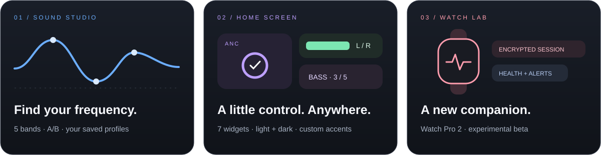

<p align="center"></p>

<p align="center">
  <a href="https://github.com/copilotfather/cmf-buds-pro-2-manager/releases/latest"></a>
  <a href="https://github.com/copilotfather/cmf-buds-pro-2-manager/actions/workflows/build-apk.yml"></a>
  
  <a href="LICENSE"></a>
</p>
<p align="center"><a href="https://github.com/copilotfather/cmf-buds-pro-2-manager/releases/latest">Download APK</a> · <a href="docs/README.ru.md">Русский</a> · <a href="docs/WATCH_BETA.md">Watch beta guide</a> · <a href="ROADMAP.md">Roadmap</a> · <a href="https://github.com/copilotfather/cmf-buds-pro-2-manager/issues/new/choose">Report a bug</a></p>

<h1 align="center">Small details. Better listening.</h1>
<p align="center">CMF Buds Pro 2 Manager · An independent Android companion</p>

An independent Android companion for **CMF Buds Pro 2**, with a sound studio, home screen widgets, listening profiles and experimental **CMF Watch Pro 2** integration. Built with Kotlin and Jetpack Compose. English and Russian interfaces.

> **Compatibility status:** advanced earbud controls are enabled only after the app identifies supported hardware revision B172. Changes are read back from the earbuds where supported; physical validation of this build is still pending. Firmware checks are advisory and installation remains in Nothing X. Watch integration is beta. This project is not affiliated with Nothing or CMF.

<p align="center">
  <a href="https://github.com/copilotfather/cmf-buds-pro-2-manager/releases/latest"></a>
</p>
<p align="center"><sub>Android 8.0+ · English / Русский · No vendor account required</sub></p>

<p align="center"></p>

<p align="center"><sub>Sound studio / Home screen controls / Watch lab — feature illustrations</sub></p>

##  Sound, in your hands

| Feature | What you get |
|---|---|
| Studio equalizer | Five bands, animated curve, presets, custom curves, JSON sharing, ±1 dB adjustments and A/B comparison |
| Listening profiles | Metro, Work, Games and Sleep; save your own ANC, bass, game mode and EQ settings |
| Connection diagnostics | Separate audio, SPP and BLE status; ANC readback and explicit command status |
| Earbud controls | B172 listening presets, custom earbud EQ, bass, game mode, in-ear detection, spatial audio, gestures and dual connection |
| Firmware | Revision-aware advisory version check with a direct path to official Nothing X updates; no direct flashing |
| Home screen widgets | Seven variants: controls, battery, ANC, transparency, game mode, bass and connection; light/dark style and accent choices |
| Battery history | Local seven-day samples, individual earbud curves and charge-imbalance warning |
| Find earbuds | Left/right acoustic signal with a safety confirmation; last known phone location at disconnect |
| Everyday tools | Sleep timer, ambient sounds, voice prompts and GitHub release updates |

##  Your home screen, your way

<table>
<tr><td width="33%" align="center"><br/><b>One-tap controls</b><br/><sub>ANC · transparency · game mode · bass</sub></td><td width="33%" align="center"><br/><b>A glance is enough</b><br/><sub>Left · case · right · connection status</sub></td><td width="33%" align="center"><br/><b>Match your setup</b><br/><sub>Light / dark · accents · configurable third button</sub></td></tr>
</table>

Add them from your launcher's widget picker → **CMF**. Appearance settings currently apply to all instances. Resize by long-pressing a widget. Compatibility with Nothing Launcher still needs physical-device testing.

##  Know your devices

| Device / capability | Status |
|---|---|
| CMF Buds Pro 2 discovery | Model-name filtering; Bluetooth pairing is managed by Android |
| ANC / bass / game mode | Firmware-dependent transport commands; ANC readback implemented, bass/game application is not independently confirmed |
| LDAC | Earbud high-quality-mode request; **Android negotiates the actual codec and bitrate** |
| EQ / audio processing | Android audio effects; effectiveness depends on phone and player audio sessions |
| CMF Watch Pro 2 | Beta BLE discovery, pairing handshake, encrypted session, health sync and notification forwarding |
| Other earbuds or watches | Not supported |

Smart Dial, spatial effects, audio relay and the remaining vendor commands still need hardware validation. Battery predictions and hearing-dose displays are estimates. Acoustic tools are not a substitute for the manufacturer's care instructions.

##  Ready when you are

1. Download **`CMF_Buds_Pro_2_Manager.apk`** from the [latest release](https://github.com/copilotfather/cmf-buds-pro-2-manager/releases/latest).
2. Allow installation from your browser/file manager when Android asks. Install on Android 8.0 or newer.
3. Pair **CMF Buds Pro 2** in Android Bluetooth settings, then open the app and grant Bluetooth permissions.
4. Add widgets through your launcher's widget picker → **CMF**. Nothing Launcher has not yet been validated on a physical phone.

Updates use GitHub Releases with fallback metadata. Android still requires installer approval. If an old installation misses an update, install the latest release APK manually.

##  Meet the Watch lab

Open **Settings → DEV**, enter **`betatestdev`**, enable beta support, scan and connect. Then select **Authenticate** and confirm pairing on the watch. Close other watch companion apps first. Pairing may replace their binding.

- Health: steps, distance, calories, heart rate, SpO₂, stress and sleep, stored locally with deduplication and a delete action.
- Notifications: explicitly enable forwarding, grant Android notification access and select apps. Only new notifications while the phone is unlocked are eligible; missed messages are not queued.
- Keys are session-only; authenticate again after reconnection. Workout summaries, Health Connect export and watch firmware updates are not implemented.

See the [beta guide](docs/WATCH_BETA.md) for limitations and troubleshooting. The DEV password is a local feature gate, not a security boundary.

##  Built to be explored

Requires **JDK 17**, Android SDK 35 and the included Gradle wrapper.

```sh
./gradlew testDebugUnitTest assembleRelease
```

Windows: `gradlew.bat testDebugUnitTest assembleRelease`.

APK output: `app/build/outputs/apk/release/app-release.apk`. Repository signing configuration is intended for development/distribution compatibility; use your own private signing key for an independent production fork. Never commit personal tokens or signing credentials.

##  Make it yours

- [Architecture](ARCHITECTURE.md) · [Release notes](CHANGELOG.md) · [Roadmap](ROADMAP.md)
- [Contributing](CONTRIBUTING.md) · [Security](SECURITY.md) · [MIT license](LICENSE)
- Maintained by [Dmitry / copilotfather](https://github.com/copilotfather).
- Watch interoperability reference: [CMF Watch Pro 2 BLE Protocol](https://github.com/joshuapassos/CMF-Watch-Pro-2-BLE-Protocol). The implementation is independent; documented behavior still needs validation against the user's firmware.

---

<p align="center">  </p>
<p align="center"><b>Less clutter. More companion.</b><br/><sub>Original SVG artwork created for this repository · Community software, with honest compatibility notes.</sub></p>
