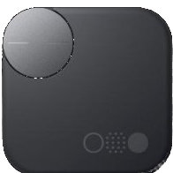

# CMF Buds Pro 2 Manager

<p align="center">
  
</p>

<p align="center">
  <b>Audiophile companion app for Nothing CMF Buds Pro 2</b><br/>
  Hardware Bluetooth controls, Sony LDAC engine, Studio Equalizer, and Liquid Gray Glass UI.
</p>

<p align="center">
  <a href="https://github.com/copilotfather/cmf-buds-pro-2-manager/releases/latest"></a>
  
  
</p>

---

## English

**CMF Buds Pro 2 Manager** is a dedicated Android app designed specifically for the **CMF Buds Pro 2** by Nothing. Built from scratch with Kotlin and Jetpack Compose, it connects directly to the earbuds' Bluetooth RFCOMM/SPP service interface to deliver hardware-level control and detailed listening telemetry.

###  Features

- **Liquid Gray Glass Design:** Clean, smoked-glass interface with high-refraction borders and smooth 60/120 FPS animations.
- **Hi-Res Codec Support:** Hardware switching and Sony LDAC up to 990 kbps (24-bit/96kHz), alongside LHDC, aptX HD, and AAC.
- **Listening & Battery Analytics:** Tracks listening duration across sound levels (0–30%, 31–70%, 71–100%), weekly listening habits, case lid openings, and estimated battery health.
- **5-Band Master Equalizer:** Real-time frequency curve drawn on GPU Canvas with studio sliders (60Hz, 230Hz, 910Hz, 3.6kHz, 14kHz) and tuned presets.
- **Continuous Noise Control:** Stepless transition between ANC (up to 50dB), Transparency, and Normal modes.
- **Hardware Utilities:** Ultra Bass boost (Levels 0–5), Smart Dial remapping, Sonic Water Eject (resonant acoustic sweeps), and Sonar finder with GPS disconnect logging.

###  Download & Install

1. Download the latest `CMF_Buds_Pro_2_Manager.apk` from [Releases](https://github.com/copilotfather/cmf-buds-pro-2-manager/releases).
2. Install the APK on your Android device (Android 8.0 or newer).
3. Connect your earbuds via Bluetooth and launch the app.

---

## Русский

**CMF Buds Pro 2 Manager** — специализированное Android-приложение для наушников **CMF Buds Pro 2** от Nothing. Разработано на Kotlin и Jetpack Compose. Приложение подключается напрямую к сервисному Bluetooth-интерфейсу наушников (RFCOMM/SPP), предоставляя доступ к аппаратным функциям и детальной статистике использования.

###  Возможности

- **Дизайн Liquid Gray Glass:** Премиальное серое дымчатое стекло, зеркальная подсветка граней и плавная работа интерфейса при 60/120 FPS.
- **Hi-Res аудиокодеки:** Аппаратное переключение и поддержка Sony LDAC до 990 кбит/с (24 бит / 96 кГц), а также LHDC, aptX HD и AAC.
- **Аналитика прослушивания:** Замер времени на разных уровнях громкости (0–30%, 31–70%, 71–100%), активность по дням недели, счётчик открытий кейса и состояние аккумулятора.
- **Студийный 5-полосный эквалайзер:** Живая кривая частотного отклика на Canvas, точная настройка полос (60 Гц, 230 Гц, 910 Гц, 3.6 кГц, 14 кГц) и готовые пресеты.
- **Плавное шумоподавление:** Режимы ANC (до 50 дБ), Прозрачность и Выключено с плавной регулировкой.
- **Инструменты:** Усилитель Ultra Bass (уровни 0–5), настройка колесика Smart Dial, выдувание воды звуком (Sonic Water Eject) и звуковой маяк Sonar с запоминанием координат GPS.

###  Установка

1. Скачайте актуальный `CMF_Buds_Pro_2_Manager.apk` в разделе [Releases](https://github.com/copilotfather/cmf-buds-pro-2-manager/releases).
2. Установите APK на Android (версия 8.0 или выше).
3. Подключите наушники по Bluetooth и откройте приложение.

---

##  Build from Source

```bash
git clone https://github.com/copilotfather/cmf-buds-pro-2-manager.git
cd cmf-buds-pro-2-manager
./gradlew assembleRelease
```

---

## 📖 Architecture & Roadmap

- 👉 **[Read the Full Architecture Documentation (ARCHITECTURE.md)](ARCHITECTURE.md)** — Protocol, packet structure, DSP & MVI state flow.
- 📋 **[Project Roadmap & Tasklist (ROADMAP.md)](ROADMAP.md)** — Current status, completed milestones, and upcoming features.

---

## 👥 Contributors

- **Dmitry ([@copilotfather](https://github.com/copilotfather))** — Creator & Lead Maintainer
- **Antigravity (Google DeepMind)** — Autonomous Architecture, SPP/BES Protocol Engineering, DSP & Cyber UI Co-Developer

---

##  License

This project is open-source under the [MIT License](LICENSE).  
Developed by [copilotfather](https://github.com/copilotfather) & Antigravity.
