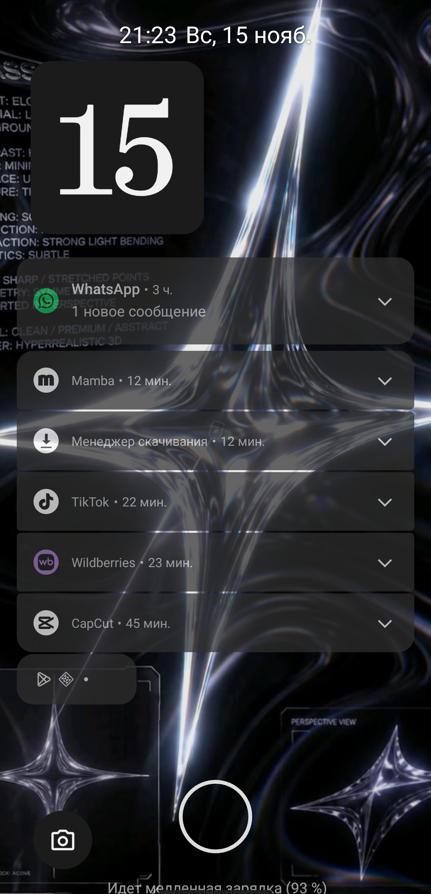

<div align="center">


# CMF Buds Pro 2 Manager

### The Definitive Audio Suite & Controller for CMF Buds Pro 2

[](https://github.com/copilotfather/cmf-buds-pro-2-manager/releases)
[](https://github.com/copilotfather/cmf-buds-pro-2-manager/releases)
[](LICENSE)
[](https://www.android.com)
[](README.md)

<br/>

<p align="center">
  <b><a href="#-english">English Documentation</a></b> • 
  <b><a href="#-русский">Русская Документация</a></b> • 
  <b><a href="https://github.com/copilotfather/cmf-buds-pro-2-manager/releases/latest">Download APK</a></b>
</p>

<br/>

<table>
  <tr>
    <td align="center"><b>📱 Overview Stage</b></td>
    <td align="center"><b>📊 Deep Analytics</b></td>
  </tr>
  <tr>
    <td></td>
    <td></td>
  </tr>
</table>

</div>

---

<a name="-english"></a>
## 🇬🇧 English Overview

CMF Buds Pro 2 Manager is a modern, high-performance Android utility engineered specifically for the **CMF Buds Pro 2** earphones ecosystem by Nothing. Built entirely with Jetpack Compose and modern Android architecture components, it pairs **hardware-level direct protocol communication** with an aesthetic **Liquid Gray Glass** design.

### 💎 Feature Showcase

<table>
  <tr>
    <td width="50%">
      <h3>🌫️ Liquid Gray Glass Interface</h3>
      <ul>
        <li><b>Smoked Glass Cards:</b> Dual-layer translucent surfaces with specular rim lighting (high-refraction edges).</li>
        <li><b>Hardware Fluidity:</b> 60 / 120 Hz render pipeline with zero frame drops.</li>
        <li><b>Floating Island Navigation:</b> Minimalist frosted pill bar with responsive active glow.</li>
      </ul>
    </td>
    <td width="50%">
      <h3>📡 Hi-Res Codec Engine</h3>
      <ul>
        <li><b>Sony LDAC:</b> High-resolution transmission up to 990 kbps (24-bit / 96 kHz).</li>
        <li><b>Hardware Switching:</b> Sends direct DSP initialization packets (<code>0xF05A</code>) straight to the earbuds.</li>
        <li><b>Broad Support:</b> LHDC V5, Qualcomm aptX HD / Adaptive, AAC, SBC.</li>
      </ul>
    </td>
  </tr>
  <tr>
    <td width="50%">
      <h3>📊 Deep Usage Analytics</h3>
      <ul>
        <li><b>Volume Distribution:</b> Time logged across Low (0–30%), Mid (31–70%), and High (71–100%) sound levels.</li>
        <li><b>Activity Histogram:</b> Day-by-day weekly breakdown with top peak days and favorite hours.</li>
        <li><b>Hardware Counters:</b> Daily & cumulative case lid open counter.</li>
        <li><b>Battery Longevity:</b> Empirical 100% full charge duration and battery health index.</li>
      </ul>
    </td>
    <td width="50%">
      <h3>🎛️ Studio Master EQ</h3>
      <ul>
        <li><b>Live Bezier Curve:</b> Real-time frequency response curve rendered on hardware Canvas.</li>
        <li><b>5-Band Discrete Tuning:</b> 60 Hz, 230 Hz, 910 Hz, 3.6 kHz, 14 kHz with ±1 dB precision.</li>
        <li><b>Pro Presets:</b> Reference, Basshead 808, Vocal Clarity, Electronic, Rock & Metal, Acoustic.</li>
      </ul>
    </td>
  </tr>
</table>

### 🚀 Additional Hardware Utilities

- 🛡️ **Continuous ANC Slider**: Off, Transparency, Active Noise Cancellation (up to 50 dB depth + Ambient Mic Auto-ANC).
- 🔊 **Ultra Bass Stepper**: Instant multi-level bass boost (Levels 0 to 5).
- 🎚️ **Smart Dial Customization**: Custom actions for dial rotation and clicks.
- 💧 **Sonic Water Eject**: High-amplitude 140–180 Hz resonant acoustic sweeps to clear moisture from driver meshes.
- 📍 **Find My Buds (Sonar)**: High-pitch dual-tone acoustic locator + last-seen GPS disconnect logging.
- 💻 **Ultra Low-Latency PC Audio Relay**: Stream high-definition PC audio to earbuds over Wi-Fi or USB.

---

### 📦 Quick Start (Installation)

```markdown
1. Head over to the [Releases](https://github.com/copilotfather/cmf-buds-pro-2-manager/releases) page.
2. Download the latest `CMF_Buds_Pro_2_Manager.apk`.
3. Open the downloaded file on your Android device and install.
```

---

<a name="-русский"></a>
## 🇷🇺 Русская Документация

CMF Buds Pro 2 Manager — это флагманский центр управления наушниками **CMF Buds Pro 2** от Nothing. Приложение объединяет **прямой аппаратно-программный протокол управления наушниками** и ультрасовременный интерфейс в стиле **Liquid Gray Glass**.

### 💎 Ключевые возможности

<table>
  <tr>
    <td width="50%">
      <h3>🌫️ Дизайн Liquid Gray Glass</h3>
      <ul>
        <li><b>Дымчатое серое стекло:</b> Матовые полупрозрачные карточки с четырёхточечными зеркальными бликами по контуру (specular reflection).</li>
        <li><b>Аппаратная плавность:</b> Оптимизированный GPU-конвейер со стабильными 60 / 120 FPS без лагов.</li>
        <li><b>Парящий стеклянный остров:</b> Лаконичный нижний бар с деликатной неоновой подсветкой.</li>
      </ul>
    </td>
    <td width="50%">
      <h3>📡 Hi-Res Аудиокодеки</h3>
      <ul>
        <li><b>Sony LDAC:</b> Студийный звук до 990 кбит/с (24 бит / 96 кГц) для аудиофильского звучания.</li>
        <li><b>Аппаратное переключение:</b> Отправка служебного пакета инициализации (<code>0xF05A</code>) прямо на чипсет наушников.</li>
        <li><b>Полный набор:</b> LHDC V5, Qualcomm aptX HD / Adaptive, AAC, SBC.</li>
      </ul>
    </td>
  </tr>
  <tr>
    <td width="50%">
      <h3>📊 Глубокая Аналитика</h3>
      <ul>
        <li><b>Распределение громкости:</b> Точный замер минут на тихой (0–30%), средней (31–70%) и высокой (71–100%) громкости.</li>
        <li><b>Гистограмма недели:</b> Наглядная активность по дням с подсветкой пиковых дней и любимого времени суток.</li>
        <li><b>Счётчик открытий кейса:</b> Учёт открытий крышки за сегодня и суммарно за всё время.</li>
        <li><b>Автономность и ресурс АКБ:</b> Расчёт средней работы от 100% и оценка износа аккумулятора.</li>
      </ul>
    </td>
    <td width="50%">
      <h3>🎛️ Студийный Мастер-Эквалайзер</h3>
      <ul>
        <li><b>Живая кривая Безье:</b> Интерактивный график частотного отклика на GPU Canvas.</li>
        <li><b>5-полосная точная настройка:</b> 60 Гц, 230 Гц, 910 Гц, 3.6 кГц, 14 кГц с шагом ±1 dB.</li>
        <li><b>Аудиофильские пресеты:</b> Reference, Basshead 808, Vocal Clarity, Electronic, Rock & Metal, Acoustic.</li>
      </ul>
    </td>
  </tr>
</table>

### 🚀 Аппаратный инструментарий

- 🛡️ **Слайдер шумоподавления**: Выкл, Прозрачность, Шумодав (до 50 дБ) + адаптивный авто-ANC по внешнему микрофону.
- 🔊 **Ultra Bass**: 6 ступеней аппаратного усиления баса (0–5).
- 🎚️ **Smart Dial**: Назначение действий на колесико кейса (вращение и клики).
- 💧 **Выталкивание воды (Sonic Water Eject)**: Резонансная акустическая волна 140–180 Гц для выдувания капель воды из сеток.
- 📍 **Поиск наушников (Sonar)**: Громкий поисковый свист + сохранение координат разрыва связи.
- 💻 **ПК Аудио Мост**: Прямая трансляция звука с компьютера на наушники через Wi-Fi/USB.

---

### 📦 Установка

1. Перейдите в раздел [Релизы (Releases)](https://github.com/copilotfather/cmf-buds-pro-2-manager/releases).
2. Загрузите файл `CMF_Buds_Pro_2_Manager.apk`.
3. Запустите файл на смартфоне (требуется Android 8.0 или новее).

---

## 🏗️ Сборка из исходников

```bash
git clone https://github.com/copilotfather/cmf-buds-pro-2-manager.git
cd cmf-buds-pro-2-manager
./gradlew assembleRelease
```

---

## 📜 License / Лицензия

This project is licensed under the **MIT License** — see the [LICENSE](LICENSE) file for details.
<br/>
Developed with passion by **[copilotfather](https://github.com/copilotfather)**.
